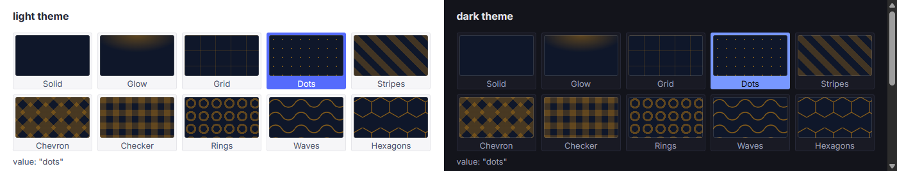

# sanity-plugin-preset-picker

A Sanity Studio field that lets editors pick a value from **visual tiles** instead of a dropdown:
hero backgrounds, colour themes, layouts, card styles. The document stores a plain string.



- Works in light and dark Studio themes (built with `@sanity/ui`).
- Keyboard and screen-reader friendly: a real radio group with arrow keys, Home and End.
- Tiles are any CSS (`style`) or an image (`image`).
- Optional **`patterns`** export: ten ready-made CSS background patterns in your colours, importable
  on your front end too.
- Fully typed `options`, so a missing `presets` list is a TypeScript error.

## Install

```sh
npm install sanity-plugin-preset-picker
```

Requires Sanity Studio v6 and React 19.2+.

## Usage

Add the plugin:

```ts
// sanity.config.ts
import { defineConfig } from 'sanity';
import { presetPicker } from 'sanity-plugin-preset-picker';

export default defineConfig({
  // …
  plugins: [presetPicker()],
});
```

Use the `presetPicker` type on any field:

```ts
import { defineField } from 'sanity';

defineField({
  name: 'heroBackground',
  title: 'Hero background',
  type: 'presetPicker',
  options: {
    presets: [
      { value: 'plain', title: 'Plain', style: { background: '#0f172a' } },
      {
        value: 'sunrise',
        title: 'Sunrise',
        style: { background: 'linear-gradient(160deg, #f97316, #7c3aed)' },
      },
      { value: 'photo', title: 'Photo', image: '/static/hero-photo-thumb.jpg' },
    ],
    emptyValue: 'plain',
  },
});
```

The field stores the chosen `value` as a string (`"sunrise"`). Query and render it however you like.

### Options

| Option       | Type       | Default | Description                                                                                                                                                         |
| ------------ | ---------- | ------- | ------------------------------------------------------------------------------------------------------------------------------------------------------------------- |
| `presets`    | `Preset[]` | –       | **Required.** The tiles, in order.                                                                                                                                  |
| `columns`    | `number`   | `3`     | Tiles per row.                                                                                                                                                      |
| `tileHeight` | `number`   | `64`    | Height of each tile preview in pixels.                                                                                                                              |
| `emptyValue` | `string`   | –       | A preset that means "nothing set". Choosing it clears the field, and an empty field shows it as selected. Without it, a **Clear** button appears once a value is set. |

Each `Preset`:

| Property      | Type            | Description                                                                 |
| ------------- | --------------- | --------------------------------------------------------------------------- |
| `value`       | `string`        | **Required.** Stored in the document.                                       |
| `title`       | `string`        | **Required.** Label under the tile.                                         |
| `description` | `string`        | Tooltip. Defaults to `title`.                                               |
| `style`       | `CSSProperties` | CSS for the tile: a colour, gradient or pattern.                            |
| `image`       | `string`        | Image URL for the tile, drawn under `style`.                                |

If a document holds a value that is no longer in `presets` (say you removed one), the field shows a
warning and the editor can pick a replacement.

## Ready-made background patterns

`sanity-plugin-preset-picker/patterns` returns ten CSS-only presets (solid, glow, grid, dots,
stripes, chevron, checker, rings, waves, hexagons) in any two colours:

```ts
import { patternPresets } from 'sanity-plugin-preset-picker/patterns';

defineField({
  name: 'heroBackground',
  type: 'presetPicker',
  options: {
    presets: patternPresets({ base: '#0f172a', accent: '#f59e0b' }),
    emptyValue: 'solid',
    columns: 5,
  },
});
```

That entry point does not import Sanity, so your front end can use the same presets to render the
background the editor chose:

```tsx
import { patternPresets } from 'sanity-plugin-preset-picker/patterns';

const backgrounds = patternPresets({ base: '#0f172a', accent: '#f59e0b' });

export function Hero({ background, children }) {
  const style = backgrounds.find((p) => p.value === background)?.style;
  return <section style={style}>{children}</section>;
}
```

The patterns use `color-mix()`, supported in all current browsers.

## Using the input on your own type

`PresetPickerInput` is exported if you want it on a string field without the plugin's type:

```ts
import { PresetPickerInput } from 'sanity-plugin-preset-picker';

defineField({
  name: 'theme',
  type: 'string',
  components: { input: PresetPickerInput },
  options: { presets: [/* … */] } as any, // `presets` isn't part of Sanity's string options type
});
```

The `presetPicker` type is the better choice in most cases because its options are type-checked.

## Development

```sh
npm install
npm test            # unit tests (Vitest + Testing Library)
npm run typecheck   # includes examples/
npm run playground  # the input in light and dark themes, no Studio needed
npm run build
```

`examples/studio` is a minimal Studio config that uses the plugin. It is type-checked with the rest of
the code.

## License

[MIT](./LICENSE)
